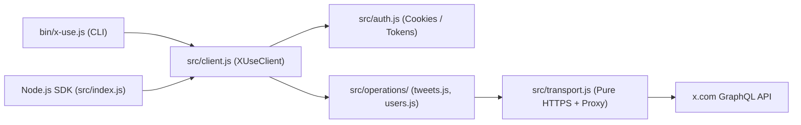

<div align="center">

<picture>
  <source media="(prefers-color-scheme: dark)" srcset="./assets/logo-dark.svg" />
  <source media="(prefers-color-scheme: light)" srcset="./assets/logo.svg" />
  
</picture>

**Browserless X (Twitter) CLI & Node.js SDK built for AI Agents (`agent-x-use`)**

[](https://nodejs.org/)
[](https://x.com)
[](./SKILL.md)
[](./package.json)

Publish tweets, chain threads, reply, delete, and query profiles over pure HTTPS — **zero Chromium, zero Puppeteer, zero Playwright.**

<br />


</div>

---

## Why `x-use`?

Traditional X automation tools spin up a full headless browser (~400 MB+ RAM, slow cold starts, brittle DOM selectors). `x-use` talks directly to X's GraphQL endpoints over Node's native `https` stack, making it ideal for:

- **AI Agents & Autonomous Workflows** (`--json` structured responses + ready-to-use `SKILL.md`)
- **Headless / Low-RAM Servers** (runs in milliseconds with minimal memory footprint)
- **Automated Publishing Pipelines** (single posts, chained threads, replies, cleanup)

---

## Architecture



### Project Structure

```text
x-use/
├── bin/
│   └── x-use.js              # CLI entrypoint (`x-use` / `agent-x-use`)
├── src/
│   ├── index.js              # Public package exports
│   ├── client.js             # XUseClient facade
│   ├── constants.js          # GraphQL query IDs, headers & feature flags
│   ├── auth.js               # Cookie file & token credential resolver
│   ├── transport.js          # Pure HTTPS transport, SOCKS5 proxy & GraphQL parser
│   └── operations/
│       ├── tweets.js         # createTweet, replyTweet, postThread, deleteTweet, like, retweet
│       └── users.js          # getProfile, getUserTweets, searchTweets
├── SKILL.md                  # AI Agent skill definition
├── package.json
└── .gitignore
```

---

## Installation

```bash
git clone https://github.com/dalroot/x-use.git
cd x-use
npm install

# Optional: expose `x-use` and `agent-x-use` globally
npm link
```

---

## Authentication

Provide credentials using **either** of these methods:

1. **Exported Browser Cookies JSON** (containing `auth_token` and `ct0`):
   ```bash
   export X_COOKIES_PATH=./cookies.json
   ```
2. **Direct Environment Tokens**:
   ```bash
   export X_AUTH_TOKEN="your_auth_token"
   export X_CT0="your_ct0_csrf_token"
   ```

**Optional Proxy:**
```bash
export X_PROXY_URL="socks5h://127.0.0.1:10808"
# or pass `--proxy socks5h://127.0.0.1:10808` per command
```

---

## CLI Usage

Run `xuse` with no arguments to launch the **interactive parent CLI menu**, or pass any subcommand directly (with `--json` for AI agents):

<p align="center">
  
</p>

| Command | Description | Example |
| :--- | :--- | :--- |
| *(no args)* | Launch interactive parent CLI hub | `xuse` |
| `setup` | Save cookies path & proxy to `~/.x-use/config.json` | `xuse setup --cookies ./cookies.json` |
| `check` | Verify session & proxy connectivity | `xuse check --json` |
| `profile <user>` | Fetch user profile metadata | `x-use profile jack --json` |
| `tweet <text>` | Publish a single tweet | `x-use tweet "Hello from x-use" --json` |
| `reply <id> <text>` | Reply to a specific tweet | `x-use reply 123456789 "Nice!" --json` |
| `thread <file.json>` | Publish an ordered thread | `x-use thread ./thread.json --json` |
| `delete <id>` | Delete a tweet by ID | `x-use delete 123456789 --json` |
| `like <id>` | Like / favorite a tweet | `x-use like 123456789 --json` |
| `retweet <id>` | Retweet a tweet | `x-use retweet 123456789 --json` |
| `tweets <user> [n]` | Fetch recent user tweets | `x-use tweets jack 10 --json` |
| `search <query> [n]` | Search tweets | `x-use search "AI agents" 10 --json` |

### Thread File Format (`thread.json`)

```json
[
  "1/3 Introducing x-use: a browserless X client built for AI agents.",
  "2/3 Zero Chromium overhead. Pure HTTPS GraphQL execution.",
  "3/3 Supports tweets, threads, replies, and JSON output out of the box."
]
```

---

## Node.js SDK Usage

```js
const { XUseClient } = require('x-use');

(async () => {
  const client = new XUseClient({
    cookiesPath: './cookies.json',
    // proxyUrl: 'socks5h://127.0.0.1:10808', // optional
  });

  await client.init();

  // Fetch a profile
  const profile = await client.getProfile('jack');
  console.log(profile.name, profile.followersCount);

  // Publish a single tweet
  const post = await client.createTweet('Hello from x-use!');
  console.log('Published:', post.url);

  // Publish a thread
  const thread = await client.postThread([
    'First tweet in the thread',
    'Second tweet chained automatically'
  ]);
  console.log('Thread length:', thread.length);
})();
```

---

## AI Agent Integration

Drop [`SKILL.md`](./SKILL.md) into your agent's skills directory (Antigravity, Claude Code, Cursor, etc.). Agents can immediately run `x-use` commands with `--json` and parse deterministic responses without brittle browser automation.

---

## Security & Privacy

- Never commit `cookies.json`, `.env`, `auth_token`, or `ct0` values to version control.
- The included `.gitignore` blocks all common cookie, session, and `.env` filenames by default.
- Rotate your session cookies immediately if you suspect exposure.

---

## License

MIT
