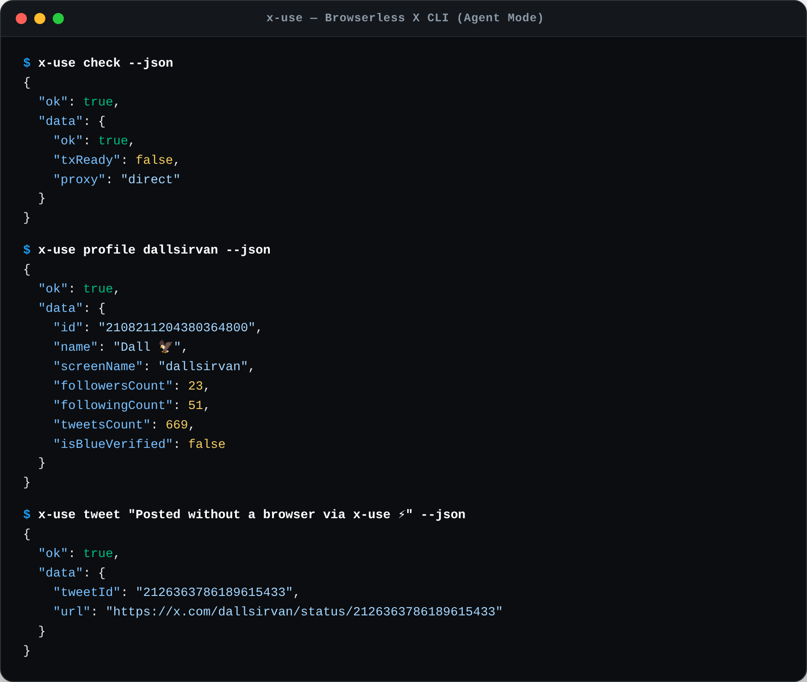
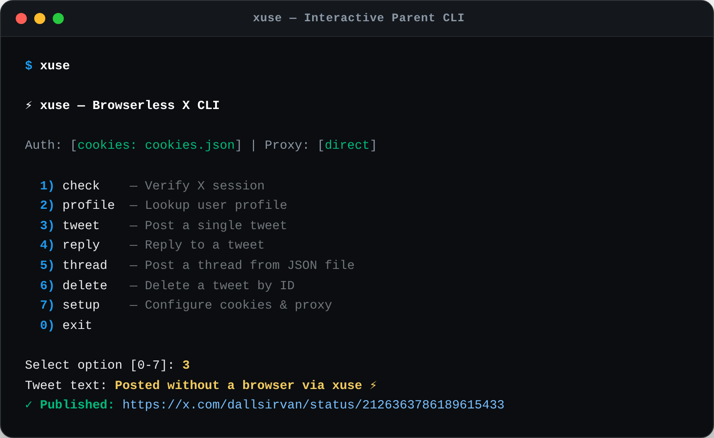
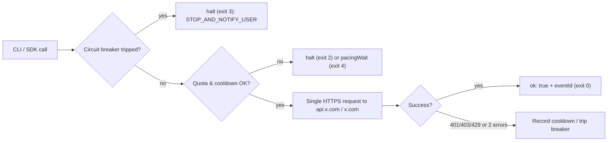

<div align="center">

<picture>
  <source media="(prefers-color-scheme: dark)" srcset="./assets/logo-dark.svg" />
  <source media="(prefers-color-scheme: light)" srcset="./assets/logo.svg" />
  
</picture>

# x-use

**A browserless X (Twitter) CLI & Node.js SDK, built for AI agents.**

Read timelines, search, fetch tweets and notifications, and publish posts over pure HTTPS,
with a built-in persistent rate limiter and safety circuit breaker. No Chromium, no Puppeteer, no Playwright.

[](https://nodejs.org/)
[](#how-it-works)
[](SKILL.md)
[](LICENSE)
[](https://dalroot.github.io/x-use/)

[Live Site](https://dalroot.github.io/x-use/) ·
[Quick Start](#quick-start) ·
[Commands](#commands) ·
[Safety Model](#safety-model) ·
[JSON Output & Exit Codes](#json-output--exit-codes) ·
[SDK](#nodejs-sdk) ·
[AI Agents](#for-ai-agents) ·
[Security](#cookie-security)



</div>

---

> [!WARNING]
> **x-use is an unofficial tool.** It uses X's internal web/GraphQL APIs (`api.x.com` and `x.com`) and authenticates with your own session cookies.
> It is not affiliated with X Corp., it can break whenever X changes its web app, and automated use may violate X's Terms of Service and lead to account restrictions.
> **Use a secondary account** and keep activity low. You are responsible for how you use it.

## Why x-use?

Most X automation tools launch a full headless browser: hundreds of MB of RAM, slow cold starts, and fragile DOM selectors. `x-use` sends HTTPS requests directly instead.

- **Lightweight.** No browser dependencies. Runs on small servers and in containers on Node.js >= 20.19.0.
- **Agent-friendly.** Every command supports `--json` with structured exit codes, and the repo includes an agent rulebook in [`SKILL.md`](SKILL.md).
- **Safety guards by default.** Persistent disk-backed rate limits, jittered spacing, a fail-closed circuit breaker, zero automatic retries, and no background polling timers.

---

## Quick Start

```bash
# 1. Install (Node.js >= 20.19.0)
git clone https://github.com/dalroot/x-use.git
cd x-use && npm install
npm link            # optional: exposes `xuse` / `x-use` / `agent-x-use` globally

# 2. Store your cookies in the encrypted vault (see "Cookie Security")
export X_USE_KEY="a-long-random-passphrase"
xuse setup --cookies ./cookies.json --encrypt
rm ./cookies.json   # delete the plaintext copy once encrypted

# 3. Verify the session
xuse check --json

# 4. Run your first command
xuse profile jack --json
```

Run `xuse` without arguments in an interactive terminal to open the menu:

<div align="center">

</div>

> The CLI is available as `xuse`. The aliases `x-use` and `agent-x-use` point to the same binary.

---

## Authentication

`x-use` only uses credentials that **you** explicitly provide. It never scans browser profile directories.

| Method | How | Recommended |
|---|---|:---:|
| Encrypted vault | `xuse setup --cookies ./cookies.json --encrypt` with `X_USE_KEY` set | ✅ |
| Cookies file | `--cookies ./cookies.json` or `X_COOKIES_PATH` (file should be `chmod 600`) | |
| Raw tokens | `X_AUTH_TOKEN` + `X_CT0` environment variables | |

**Cookie file format.** Export your `x.com` cookies as a JSON array. Only `auth_token` and `ct0` are required; if a `domain` field is present, only `x.com` and `twitter.com` cookies are accepted (foreign domains are ignored):

```json
[
  { "name": "auth_token", "value": "…" },
  { "name": "ct0", "value": "…" }
]
```

**Proxy (optional).** Both SOCKS (`socks5h://`, `socks5://`, `socks4://`) and HTTP CONNECT (`http://`) proxies are supported:

```bash
export X_PROXY_URL="socks5h://127.0.0.1:10808"   # or http://127.0.0.1:10808, or --proxy
```

---

## Commands

All commands accept `--json`. Default counts are shown in brackets.

### Read & Discover (`api.x.com` `x-web` GraphQL)

| Command | Description |
|---|---|
| `xuse check` | Verify session connectivity and proxy (redacts proxy passwords) |
| `xuse profile <user>` | Public profile metadata (name, bio, followers, …) |
| `xuse tweets <user> [20]` | A user's original tweets |
| `xuse reposts <user> [20]` | A user's reposts |
| `xuse search "<query>" [20]` | Search the latest tweets |
| `xuse read <url\|id>` | Fetch a single tweet with text, author, stats, and expanded links |
| `xuse home [20]` | Your Home timeline |
| `xuse explore [20]` | The Explore feed |
| `xuse suggest "<keyword>"` | Search autocomplete suggestions |

### Notifications (on demand only)

| Command | Description |
|---|---|
| `xuse badges` | Lightweight unread counters (~100 bytes) |
| `xuse notifications [40]` | Full notification list — call only when `badges` reports unread items |

There is no background timer or polling loop. Nothing runs unless you invoke a command.

### Write (requires explicit user confirmation when used by agents)

| Command | Description |
|---|---|
| `xuse tweet "<text>"` | Publish a tweet |
| `xuse reply <id> "<text>"` | Reply to a tweet |
| `xuse thread <file.json>` | Publish a thread from a JSON array of strings |
| `xuse like <id>` | Like a tweet |
| `xuse retweet <id>` | Retweet a tweet |
| `xuse delete <id>` | Delete one of your tweets |

<details>
<summary><b>Thread file format & pacing</b></summary>

```json
[
  "1/3 Introducing x-use: a browserless X client built for AI agents.",
  "2/3 Pure HTTPS. No Chromium.",
  "3/3 JSON output and safety limits out of the box."
]
```

Each tweet in a thread counts as one write. `postThread` checks your remaining 60-minute write budget **before** starting, enforces the 15–30 s write spacing internally between tweets `#2..N` so confirmed threads complete cleanly (allow a few minutes for multi-tweet threads), and returns any already-published tweets if a network error interrupts mid-thread.

</details>

### Safety & Setup

| Command | Description |
|---|---|
| `xuse limits` | Remaining read/write budget, cooldown, and the latest `eventId` |
| `xuse breaker` | Circuit breaker status and the last error |
| `xuse reset-breaker` | Re-enable requests (**human TTY only** — rejected in `--json` / non-TTY) |
| `xuse reset-limits` | Reset window counters/cooldown (**human TTY only** — rejected in `--json` / non-TTY) |
| `xuse setup` | Save cookies path / encrypted vault and proxy to `~/.x-use/config.json` |

### Options

| Flag | Description |
|---|---|
| `--json` | Structured JSON output (enables `--strict` pacing automatically) |
| `--strict` | Exit with code `4` (`pacingWait: true`) instead of sleeping when pacing gap is not met |
| `--cookies <path>` | Cookies JSON file |
| `--encrypt` | With `setup`: store cookies in `~/.x-use/cookies.vault` using `X_USE_KEY` |
| `--proxy <url>` | SOCKS5 or HTTP proxy URL (`socks5h://`, `http://`, …) |
| `-h, --help` | Show help |

---

## Safety Model

Every request from both the CLI and the SDK goes through persistent guards stored in `~/.x-use/`. Concurrency across parallel `Promise.all` calls and separate CLI processes is serialized via an in-process queue, lockfile, and atomic temp-rename writes.

| Guard | Rule | What happens |
|---|---|---|
| **Read cap** | Max 50 requests / 15 min | Blocked with `halt: true`, exit code `2` |
| **Write cap** | Max 15 requests / 60 min | Blocked with `halt: true`, exit code `2` |
| **Read pacing** | 3–6 s jittered gap between reads | Sleeps interactively; returns `pacingWait: true` (`halt: false`, exit `4`) in `--strict`/`--json`/non-TTY |
| **Write pacing** | 15–30 s jittered gap between writes | Sleeps interactively; returns `pacingWait: true` (`halt: false`, exit `4`) in `--strict`/`--json`/non-TTY |
| **Circuit breaker** | Immediate trip on `401`/`403`/`429` (plus server `retry-after` cooldown) or account-restriction GraphQL errors; or 2 consecutive errors | Blocked with `halt: true`, exit code `3`, until a human runs `xuse reset-breaker` (cannot be cleared by late `recordSuccess()`) |
| **Ledger integrity** | Corrupt state files or clock rollback (> 2 min) | Fails closed (`halt: true`) instead of resetting counters |
| **Retries** | None | Each HTTP request is attempted once so posts are never duplicated |

Every request records an incrementing **`eventId`**, an **ISO-8601 UTC timestamp**, and the operation name only (never search queries, tweet text, or cookies).

> [!NOTE]
> These guards prevent accidental overuse and runaway agent loops. They are not an OS sandbox against a caller with write access to the host filesystem.

---

## JSON Output & Exit Codes

**Exit codes:** `0` success · `1` general error · `2` quota exhausted / cooldown (`halt: true`) · `3` circuit breaker tripped (`halt: true`) · `4` short pacing wait (`halt: false`, `pacingWait: true`).

**Success** (`stdout`, exit code `0`):

```json
{
  "ok": true,
  "event": { "eventId": 42, "timestamp": "2026-11-28T10:15:03.120Z", "kind": "read", "waitedMs": 0 },
  "data": { "...": "command result" }
}
```

**Short pacing wait** (`stderr`, exit code `4`):

```json
{
  "ok": false,
  "error": "Pacing guard: read called 420ms after event #42 (2026-11-28T10:15:03.120Z). Wait 5s before the next request.",
  "halt": false,
  "pacingWait": true,
  "waitSeconds": 5
}
```

**Hard stop — quota / cooldown or tripped breaker** (`stderr`, exit code `2` or `3`):

```json
{
  "ok": false,
  "error": "Safety rate limit reached (15/15 write requests in window, lastEventId=#42). Halting to protect X account. Retry after 420s.",
  "halt": true,
  "actionRequired": "STOP_AND_NOTIFY_USER",
  "rateLimitExceeded": true,
  "retryAfterSeconds": 420
}
```

| Field | Meaning |
|---|---|
| `halt` | `true` means stop all calls immediately and notify the user |
| `pacingWait` | `true` (exit `4`) means wait `waitSeconds` and retry at most once |
| `actionRequired` | `STOP_AND_NOTIFY_USER` when human attention is required |
| `circuitBreakerTripped` | `true` (exit `3`) when the safety breaker is open |
| `rateLimitExceeded` | `true` (exit `2`) when window cap, cooldown, or ledger guard was hit |
| `retryAfterSeconds` | Seconds until the rate-limit window or server `429` cooldown clears |

---

## Node.js SDK

```js
const { XUseClient } = require('x-use'); // after `npm link x-use` in your project

const client = new XUseClient({
  cookiesPath: './cookies.json',   // or rely on the vault + X_USE_KEY
  strictRateLimit: true            // recommended for automated callers
});

try {
  const profile = await client.getProfile('jack');
  console.log(profile.name, profile.followersCount);

  const tweet = await client.getTweet('https://x.com/jack/status/20');
  console.log(tweet.text, tweet.links);
} catch (err) {
  if (err.halt) {
    // CIRCUIT_BREAKER_TRIPPED or RATE_LIMIT_EXCEEDED: stop and tell the user
    console.error(err.code, err.message, err.retryAfterSeconds);
  } else {
    throw err;
  }
}
```

> **Note (`v1.1.0`):** `getUserTweets(screenName, count, cursor)` now takes a `screenName` handle via `api.x.com` `UserOriginalsTimeline` rather than a numeric `userId`. `maxReads`, `maxWrites`, `maxErrors`, and gap options on `XUseClient` can only make safety limits stricter, never looser.

<details>
<summary><b>All SDK methods</b></summary>

| Read | Write | Safety |
|---|---|---|
| `getProfile(screenName)` | `createTweet(text)` | `getRateLimitStatus()` |
| `getUserTweets(screenName, count, cursor)` | `replyTweet(id, text)` | `getCircuitBreakerStatus()` |
| `getUserReposts(screenName, count, cursor)` | `postThread(tweets)` | |
| `searchTweets(query, count, product, cursor)` | `favoriteTweet(id)` | |
| `getTweet(idOrUrl)` | `retweet(id)` | |
| `getHomeTimeline(count, cursor)` | `deleteTweet(id)` | |
| `getExplore(count, timelineId, cursor)` | | |
| `getNotifications(count, type, cursor)` | | |
| `getBadgeCounts()` | | |
| `searchTypeahead(query)` | | |

Every method is documented with JSDoc in [`src/client.js`](src/client.js).

</details>

---

## For AI Agents

Load [`SKILL.md`](SKILL.md) into your agent's skills directory. In short:

1. **Always pass `--json`** and parse exit codes (`0`, `1`, `2`, `3`, `4`).
2. **`"halt": true` (exit `2` or `3`) means STOP immediately.** Do not retry, never touch `~/.x-use/`, and never attempt `reset-breaker` or `reset-limits`. Report the exact `error` to the user.
3. **`"pacingWait": true` (exit `4`) means wait `waitSeconds`** and retry the same command **once at most**.
4. **Ask before writing.** `tweet`, `reply`, `thread`, `like`, `retweet`, and `delete` require explicit user confirmation.
5. **Sequential execution.** Execute multi-item tasks one by one, never in parallel bursts.
6. **Check `badges` before `notifications`.**

---

## Cookie Security

Your `auth_token` cookie is equivalent to an active session credential. Treat it accordingly.

- **Use the vault.** Cookies are encrypted with `AES-256-GCM` (key derived via `scryptSync` with random salt and IV) and stored at `~/.x-use/cookies.vault`. Delete the plaintext JSON file afterwards.
- **Owner-only permissions.** Everything in `~/.x-use/` is written with mode `0600`, and `setup` warns on permissive plaintext cookie files.
- **Destination & domain isolation.** Foreign-domain cookies are filtered out before building headers; credentials are sent only to `x.com` and `api.x.com` and never printed in errors or `--json` outputs. Proxy credentials are redacted (`***:***@`).
- **Know the trust boundary.** The vault protects cookies at rest on disk. Any process running in the same environment where `X_USE_KEY` is exported (including an AI agent) can decrypt it.
- **Rotate after exposure.** If cookies may have leaked, log out of X sessions immediately. Removing a file from git history is not sufficient.

<details>
<summary><b>Files in <code>~/.x-use/</code></b></summary>

| File | Contents |
|---|---|
| `config.json` | Cookies path / vault path, proxy |
| `cookies.vault` | Encrypted cookies (`AES-256-GCM`) |
| `rate_limit.json` | Request ledger (`eventId`, UTC ISO timestamp, operation name, cooldown) |
| `circuit_breaker.json` | Error counter and last error |

</details>

---

## Troubleshooting

| Symptom | Likely cause | Fix |
|---|---|---|
| `401` | Session cookies expired | Export fresh cookies and re-run `xuse setup`; a human must run `xuse reset-breaker` |
| `403` | Account or request restricted | Stop immediately and inspect the account in a browser before resetting |
| `429` | Rate-limited by X | Respect stored cooldown, wait, then a human reviews and resets when safe |
| `404` on all calls | X rotated GraphQL query IDs | Update `DEFAULT_QUERY_IDS` in [`src/constants.js`](src/constants.js) or pass `queryIds` |
| `circuitBreakerTripped` (exit `3`) | Sensitive status or 2 consecutive errors | Inspect `xuse breaker`, fix cause, then a human runs `xuse reset-breaker` |
| `rateLimitExceeded` (exit `2`) | Budget exhausted or cooldown active | Wait `retryAfterSeconds` and check `xuse limits` |
| `pacingWait` (exit `4`) | Short pacing gap not elapsed | Wait `waitSeconds` and retry the command once |
| `Missing X authentication` | No credentials or missing `auth_token`/`ct0` | Export `X_USE_KEY` for vault, or pass valid `x.com` cookies |

---

## How it works



1. **Circuit breaker.** Fails closed once tripped; only an interactive human `reset-breaker` restores it.
2. **Rate limiter.** Enforces window caps, pacing, and `429` cooldowns atomically across processes.
3. **Transport.** Single HTTPS attempt with 35 s timeout over direct socket, SOCKS (`SocksProxyAgent`), or HTTP `CONNECT` proxy (`HttpConnectAgent`).
4. **Output.** Normalized JSON tweets with text, author, engagement stats, and expanded links.

<details>
<summary><b>Project structure</b></summary>

```text
x-use/
├── bin/x-use.js              # CLI entry point (xuse / x-use / agent-x-use)
├── src/
│   ├── index.js              # Package exports
│   ├── client.js             # XUseClient: auth, headers, safety guards
│   ├── auth.js               # Domain-filtered credentials + AES-256-GCM vault
│   ├── circuit_breaker.js    # Fail-closed safety circuit breaker
│   ├── rate_limiter.js       # Persistent lockfile-backed caps, pacing & eventId ledger
│   ├── transport.js          # Single-attempt HTTPS transport + SOCKS/HTTP CONNECT proxy
│   ├── constants.js          # GraphQL query IDs and Relay/feature defaults
│   └── operations/
│       ├── tweets.js         # tweet, reply, thread, delete, like, retweet
│       └── users.js          # profile, timelines, search, read, notifications
├── test/x-use.test.js        # Offline unit & CLI subprocess tests (node --test)
├── SKILL.md                  # Agent rulebook
├── SECURITY.md               # Vulnerability reporting & security model
├── LICENSE                   # MIT License
└── package.json
```

</details>

---

## Development

```bash
npm test    # syntax check + offline unit & CLI tests (no network, no real cookies)
```

Contributions are welcome. Never include real cookies, HAR files, or tokens in issues, tests, or pull requests.

Found a security vulnerability? Please report it privately as described in [`SECURITY.md`](SECURITY.md) instead of opening a public issue.

## License

[PolyForm Noncommercial 1.0.0](LICENSE) © dalroot — see [`NOTICE`](NOTICE).

- **Personal & open contribution:** Free for personal, research, educational, and noncommercial development; pull requests are welcome.
- **No commercial use:** Selling, commercial deployment, or paid SaaS hosting is not permitted without written permission.
- **No rebranding / attribution removal:** Copies and forks must preserve the `Required Notice:` in [`NOTICE`](NOTICE) and may not use the `x-use` name or logo to mislead or rebrand as an original work.
